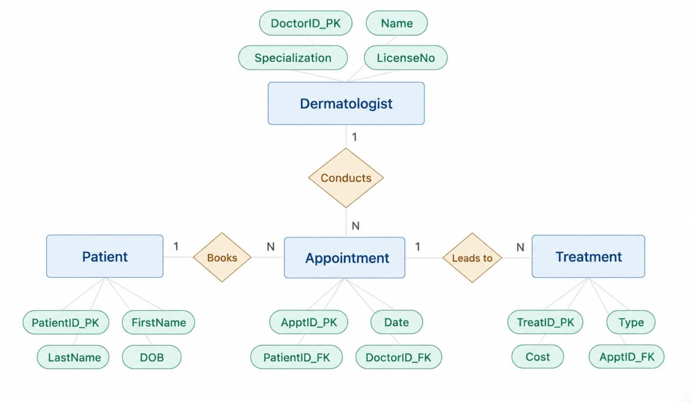
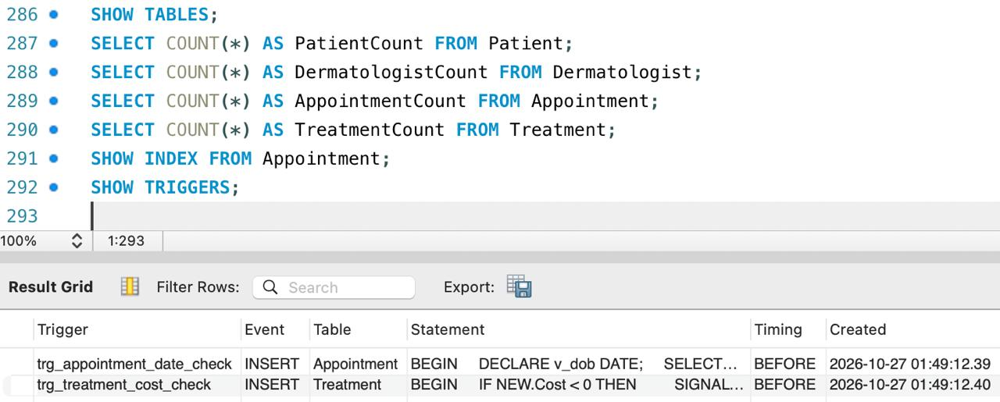

# Dermatology Clinic Management System (MySQL)

A relational database for a dermatology clinic that links patients, dermatologists, appointments and treatments. Built as an RDBMS lab project (Case 2) at Manipal University Jaipur.

## Features

- **Normalized schema** with primary keys, foreign keys, `CHECK`, `UNIQUE` and `DEFAULT` constraints
- **Joins and subqueries** for visit histories, doctor workloads and treatment totals
- **Views** for appointment and treatment reports
- **Triggers** that reject appointments dated before a patient's birth date and negative treatment costs
- **Stored procedures and a function**, including a procedure that uses a cursor to list and total treatments
- **Indexes** on the main foreign keys and the doctor/date lookup
- **Transaction control** with `SAVEPOINT` and `ROLLBACK`

## Tech Stack

- MySQL 8.0+
- MySQL Workbench

## ER Diagram



## Schema

| Table | Key columns |
|---|---|
| `Patient` | PatientID (PK), FirstName, LastName, DOB, Phone |
| `Dermatologist` | DoctorID (PK), Name, Specialization, LicenseNo (UNIQUE) |
| `Appointment` | ApptID (PK), Date, PatientID (FK), DoctorID (FK) |
| `Treatment` | TreatID (PK), Type, Cost, ApptID (FK) |

Relationships: a patient can have many appointments, a dermatologist can have many appointments, and an appointment can have many treatments.

## Setup

**Option 1: MySQL Workbench**
1. Open MySQL Workbench and connect to your local server.
2. Go to **File → Open SQL Script** and select `dermatology_clinic.sql`.
3. Click the lightning icon (**Execute**) to run the whole script.

**Option 2: Command line**
```bash
mysql -u root -p < dermatology_clinic.sql
```

The script creates the `dermatology_clinic` database, builds the tables, loads sample data (8 patients, 4 dermatologists, 10 appointments, 12 treatments), and creates the views, triggers, procedures and function.

## Example Usage

```sql
USE dermatology_clinic;

-- List all tables in the database
SHOW TABLES;

-- Check the row count in each table
SELECT COUNT(*) AS PatientCount FROM Patient;
SELECT COUNT(*) AS DermatologistCount FROM Dermatologist;
SELECT COUNT(*) AS AppointmentCount FROM Appointment;
SELECT COUNT(*) AS TreatmentCount FROM Treatment;

-- Show the indexes on the Appointment table
SHOW INDEX FROM Appointment;

-- List the triggers that enforce business rules
SHOW TRIGGERS;
```



## Documentation

The full project report, with requirements, design, implementation and output, is in [`docs/Dermatology_Clinic_Project_Report.pdf`](Project_Report.pdf).

## Future Scope

- Login and role-based access for clinic staff
- A simple interface for booking appointments and updating treatments
- Date-wise and doctor-wise reports with privacy controls

## Author

**Hitesh Pundhir**
B.Tech CSE, Manipal University Jaipur
GitHub: [@hiteshpundhir25](https://github.com/hiteshpundhir25) · Email: hiteshpundhir25@gmail.com
